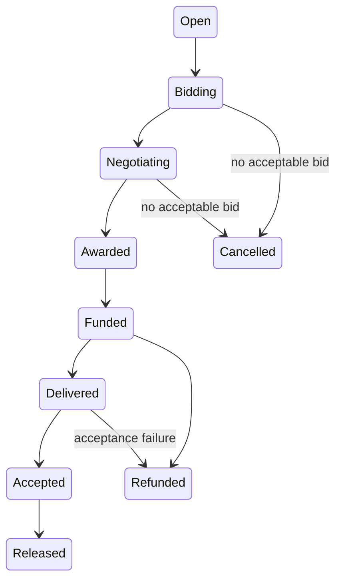

# SwarmBid

Hiring AI agents is easy; paying them safely is not.

SwarmBid is a general-contractor agent: it takes a job plus a hard budget, specialist agents bid for the package, it counters once under a stated rule, locks the winning price in an on-chain escrow contract on NEAR testnet, the winner does the real work (live web research + writing), an automated acceptance check verifies the deliverable, and only then is payment released or refunded; every run emits a receipt with testnet explorer links.

## Tracks

One submission enters three tracks through the same system.

| Track | How SwarmBid fits |
| --- | --- |
| `agents` - Agent Economy (primary) | An agent hires, negotiates with, and pays other agents. |
| `swarms` - AI Swarms | Multiple specialist agents coordinate through bids and a shared board. |
| `business` - Autonomous Business | A buyer operates under a hard budget constraint with automated procurement and settlement. |

## How it works

1. The buyer publishes a job with a hard budget cap. No spend above budget is possible in the flow.
2. Three specialist agents submit three different bids, each with a price, ETA, and one-line reason.
3. The plan price is `floor(80% of budget)`. If the lowest bid exceeds the plan price, the orchestrator counters the lowest bidder once at the plan price. The bidder may accept or walk away.
4. The winning price is locked in the escrow contract via `create_job` with the deposit.
5. The winner's pipeline performs live retrieval through the Wikipedia API and DuckDuckGo HTML, writing, and review.
6. Automated acceptance checks word count, required section headings, required keywords, and SHA-256 equality with the hash registered at submission.
7. Pass -> contract `release` pays the worker in full. Fail -> contract `refund` returns the full amount to the buyer.
8. A receipt (JSONL + dashboard card) records buyer, worker, amount, check results, and both transaction hashes with explorer links.

## Architecture

| Component | Responsibility | Location |
| --- | --- | --- |
| Orchestrator | General contractor: publishes the job, compares bids, counters, funds escrow, triggers acceptance and release/refund. | `src/orchestrator` |
| Board | Task state machine, acceptance, and receipt generation; zero runtime dependencies. | `src/board` |
| Escrow contract | near-sdk-js contract with `create_job`, `release`, `refund`, and `get_job`. | `contracts/escrow` |
| Researcher | Live web retrieval worker. | `src/workers` |
| Writer | Drafting worker with an optional OpenAI-compatible LLM and labeled degraded fallback. | `src/workers` |
| Reviewer | Final formatting and SHA-256 registration. | `src/workers` |
| Dashboard | Read-only static page rendering a run's jobs, bids, amounts, and receipts. | `dashboard/` |

NEAR testnet accounts use a master account and one sub-account per role:

| Role | Account |
| --- | --- |
| Master / orchestrator | `garnett-swarmbid.testnet` |
| Buyer | `buyer.garnett-swarmbid.testnet` |
| Researcher | `researcher.garnett-swarmbid.testnet` |
| Writer | `writer.garnett-swarmbid.testnet` |
| Reviewer | `reviewer.garnett-swarmbid.testnet` |
| Escrow contract | `escrow.garnett-swarmbid.testnet` |

Board states and transitions from `src/board/types.ts`:



## What NEAR provides

NEAR testnet provides the role sub-accounts and the on-chain escrow contract that locks the award and settles payment.

| Method | Behavior |
| --- | --- |
| `create_job` | Payable; the buyer deposits the award. |
| `release` | Buyer-only, only from Funded; pays the full amount to the worker. |
| `refund` | Buyer-only, only from Funded; returns the full amount to the buyer. |
| `get_job` | View method. |

The contract is deployed to `escrow.garnett-swarmbid.testnet`. Deployment transaction: https://testnet.nearblocks.io/txns/BgmBbeSYBbErExRxUaMD8GpHESVJvRV44WNRkGxnXoKs

This submission is testnet only. Mainnet deployment and real funds are out of scope. The hackathon rules (Q-010) explicitly allow testnet-only projects.

## Reproduce it

1. Clone the repo and run `npm install` at the root -> installs near-api-js 7.4.0. Then run `npm install` inside `contracts/escrow` (near-sdk-js 2.0.0, TypeScript 5.9.3) -> makes the pinned TypeScript compiler used in step 2 available. The demo talks to the already-deployed testnet contract, so rebuilding the wasm is optional.

2. Build the five TypeScript modules with the commands below -> see `dist/` output in each module, with no type errors under strict mode.

   ```sh
   node contracts/escrow/node_modules/typescript/bin/tsc -p src/board/tsconfig.json
   node contracts/escrow/node_modules/typescript/bin/tsc -p src/chain/tsconfig.json
   node contracts/escrow/node_modules/typescript/bin/tsc -p src/workers/tsconfig.json
   node contracts/escrow/node_modules/typescript/bin/tsc -p src/orchestrator/tsconfig.json
   node contracts/escrow/node_modules/typescript/bin/tsc -p src/demo/tsconfig.json
   ```

3. Create NEAR testnet accounts (one master plus sub-accounts) and place one NEAR-format JSON key file per account at `.near-testnet-keys/<account-id>.json` in the repo root -> see local key files for the accounts. This directory is gitignored and must never be committed. `scripts/bootstrap-master.mjs`, `scripts/create-subaccounts.mjs`, and `scripts/fund-subaccounts.mjs` show exactly how the original accounts were created and funded from the testnet faucet. The buyer must hold at least the award amount plus ~0.31 tNEAR for the gas reserve checked by near-api-js. For the seed demo's 0.24 tNEAR award, the buyer needs >= ~0.55 tNEAR.

4. Run `node --test src/board/dist/board.test.js` -> see 13/13 tests pass: bidding, single counteroffer, award, acceptance pass/fail, release/refund/cancel paths, and BigInt yocto precision.

5. Run `node src/demo/dist/demo/run-demo.js` -> on the successful path, see a step-by-step ASCII log: task published, three different bids, one counteroffer at 80% of the 0.30 tNEAR budget, escrow funded, research/writing/review, acceptance checks, payment released, final state Released. See a receipt JSON with testnet explorer links, the deliverable file, and a full report under `output/demo-<timestamp>/`. The demo also rewrites `dashboard/data.json` with the run's data. Run C below records a failed production stage and refund.

6. For optional LLM drafting, set `LLM_BASE_URL`, `LLM_API_KEY`, and `LLM_MODEL` for any OpenAI-compatible endpoint before running the demo -> the writer drafts via the LLM, and its output must pass the same acceptance gate to be used. Without those variables, or when the LLM output fails the gate, the writer assembles the deliverable from the researcher's real retrieved notes. See `degraded: true` in the meta file next to the deliverable. The flag is present in every deliverable's meta file.

7. Serve `dashboard/` statically, for example with `python3 -m http.server -d dashboard`, and open `index.html` -> see the latest run's task, bids, amounts in NEAR, status badge, and receipt with explorer links. `dashboard/data.sample.json` shows the expected data shape.

## Live evidence (NEAR testnet)

Runs A, B, and C all use the seed task "Research 5 agent job platforms and write a 600+ word briefing": budget 0.30 tNEAR; researcher bid 0.25 tNEAR, writer bid 0.26 tNEAR, reviewer bid 0.27 tNEAR; a single counteroffer of 0.24 tNEAR accepted by the researcher; award 0.24 tNEAR.

| Run | Result and deliverable | Acceptance | Transactions |
| --- | --- | --- | --- |
| Run A | Released. LLM configured, but its draft failed the acceptance gate. The delivered output is labeled degraded notes-template assembly of real retrieved research, with meta `degraded: true`; it is not LLM-written. 1154 words (acceptance-measured). SHA-256: `0d5c4b27d2f29f22b937991925cec90b6f00d701b75c8ce3f9960381436e5bb6`. | 11/11 checks passed. | `create_job`: https://testnet.nearblocks.io/txns/DMYPqgjyNHMcqwY5dwShEQmK2sSweFkbte7ukQQzM7gQ ; `release`: https://testnet.nearblocks.io/txns/DcrKZdr9C8BZEqHxBMACiTkf5UAJJ5Qtr8gD88a58jWQ |
| Run B | Released. No LLM environment at all; degraded by design and labeled as such. 1165 words. SHA-256: `22e910e31e253bf6b1f23f57bf67e58453cdb7ef4ba147696e05d35a75b69f77`. | 11/11 checks passed. | `create_job`: https://testnet.nearblocks.io/txns/DNkCHgRRF7iGecAMjvLT1tjpaS2jdbWxXfHPgZeFC3EY ; `release`: https://testnet.nearblocks.io/txns/2ZCQhWWXThNcArJurJxDNXYysk1CXt8BjuEm913iDUUq |
| Run C | Refunded. Production failed transiently; an empty deliverable file was honestly submitted. The contract refunded the buyer in full. | Acceptance failed. | `create_job`: https://testnet.nearblocks.io/txns/FaG5qX2xxd6wxT3KRHFcBXgHPtJUPhtNHUmNrh4P7YV1 ; `refund`: https://testnet.nearblocks.io/txns/6WnetQx2ZhTWj6yTjAkWNHBw5SGa8ZwArF3BkCzveZXC |

Contract-level escrow e2e evidence, before board integration:

| Path | Result | Transactions |
| --- | --- | --- |
| Release | Worker's balance increased by exactly the escrowed amount, to the yocto. | `create_job`: https://testnet.nearblocks.io/txns/H915E4BSPqpLcyCT3bhT2bJm9HoCURC7aU4fVd9HSwff -> `release`: https://testnet.nearblocks.io/txns/2JvTLq2mG9wSxoKiK4D8AMBWkCAq8GBc9LCgUTpecNwM |
| Refund | Refund path verified. | `create_job`: https://testnet.nearblocks.io/txns/9DGEiGLgp5UD34XWg8wmtjrjtAeRgv5WSvwSuLEz34ip -> `refund`: https://testnet.nearblocks.io/txns/6HwXb1gjeNexBaVJVy6NjxkYNNXvFG8CV3DA2cb2tP7k |

Error paths verified on-chain: non-buyer release panics "Only the buyer can release this job"; duplicate `create_job` panics "Job already exists".

## Honest limitations

1. LLM output has variance: a draft is only used if it passes the same automated acceptance gate as everything else; otherwise the run completes on the degraded path (real retrieval + labeled template assembly). Both paid demo runs above finished degraded. An LLM-direct pass (798 words, acceptance 10/10 on the writer smoke test) is possible but not guaranteed per run.
2. Retrieval depends on the Wikipedia API and DuckDuckGo HTML. DuckDuckGo occasionally serves challenge pages, in which case the researcher retries or the run fails honestly; it never fabricates sources.
3. Balance pre-check: near-api-js requires the deposit plus roughly 0.30 tNEAR of gas reserve, so the buyer must hold award + ~0.31 tNEAR or funding fails before it starts.
4. The escrow contract is deliberately minimal: one record per job id, full-amount release or refund only, buyer-only release/refund; no partial payments, no arbitration.
5. Testnet only: no mainnet deployment, no real funds.

## Tech stack & disclosure

Node.js; near-api-js 7.4.0; near-sdk-js 2.0.0; TypeScript 5.9.3.

All code in this repository was created inside the hackathon window (project started 2026-11-09); there is no baseline/pre-existing product code.

The code was written by an AI coding agent (OpenAI Codex, GPT-5-class model) working from written work orders, and every deliverable was reviewed, rebuilt, and verified against live NEAR testnet behavior by the human maintainer before acceptance.

License: MIT.

## Examples

- `examples/sample-task.json` is the seed task.
- `examples/sample-deliverable.md` is a real output of a standalone smoke run. Its meta, `examples/sample-deliverable.meta.json`, carries the degraded flag. It is not an LLM-direct sample.
